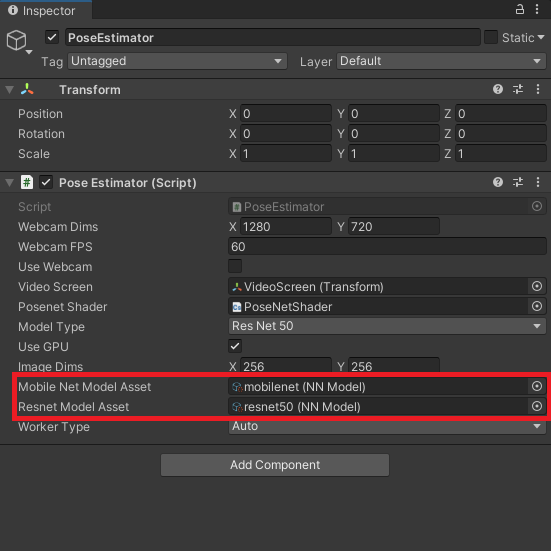
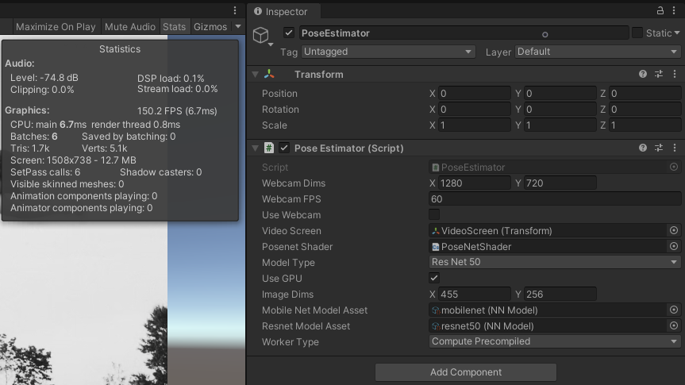
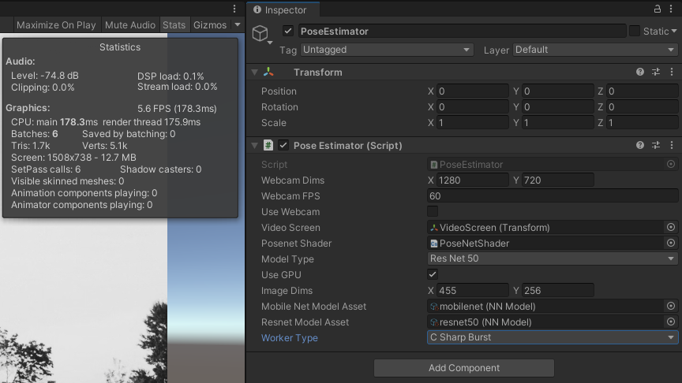

# Barracuda PoseNet Tutorial 2nd Edition Pt. 4

> [!NOTE]
> **Retired from [christianjmills.com](https://christianjmills.com) on 2026-10-09.** This post was first published on 2021-07-28 at <https://christianjmills.com/posts/barracuda-posenet-tutorial-v2/part-4/>, which now redirects here. It is kept as it was written; its tools and steps may be out of date.
>
> Source: [`posts/barracuda-posenet-tutorial-v2/part-4/index.md@8229e99`](https://github.com/cj-mills/christianjmills/blob/8229e991c0be7f8c78a909f0d8a2ca74390dc1e6/posts/barracuda-posenet-tutorial-v2/part-4/index.md)

*Load, modify, and execute the PoseNet models.*

- [Overview](#overview)
- [Update `PoseEstimator` Script](#update-poseestimator-script)
- [Assign Model Assets](#assign-model-assets)
- [Test it Out](#test-it-out)
- [Summary](#summary)

## Overview

In this post, we will cover how to load, modify, and execute the PoseNet models. We will also be comparing the relative efficiency of the ResNet50 and MobileNet versions of the model using the GPU and CPU [backends](https://docs.unity3d.com/Packages/com.unity.barracuda@2.1/api/Unity.Barracuda.WorkerFactory.Type.html) for the Barracuda library.

## Update `PoseEstimator` Script

Before we can execute the models, we need to add some new variables and add a new layer to the end of the selected model.

### Add Public Variables

The ONNX files that we imported into the Assets section in part 1 are automatically converted into Barracuda model assets called [`NNModels`](https://docs.unity3d.com/Packages/com.unity.barracuda@2.1/api/Unity.Barracuda.NNModel.html). We need to add a couple `public NNModel` variables for the MobileNet and ResNet models.

We will also add a `public` [`WorkerFactory.Type`](https://docs.unity3d.com/Packages/com.unity.barracuda@2.1/api/Unity.Barracuda.WorkerFactory.Type.html) variable so that we can switch between the available Barracuda backends while the project is running. Give this variable a default value of `WorkerFactory.Type.Auto`. This will automatically select the best backend for the platform.

``` c#
[Tooltip("The MobileNet model asset file to use when performing inference")]
public NNModel mobileNetModelAsset;

[Tooltip("The ResNet50 model asset file to use when performing inference")]
public NNModel resnetModelAsset;

[Tooltip("The backend to use when performing inference")]
public WorkerFactory.Type workerType = WorkerFactory.Type.Auto;
```

### Add Private Variables

To perform inference with the Barracuda library, we first need to generate an [object-orientated representation](https://docs.unity3d.com/Packages/com.unity.barracuda@2.1/api/Unity.Barracuda.Model.html#methods) of the model. We then create an [`IWorker`](https://docs.unity3d.com/Packages/com.unity.barracuda@2.1/api/Unity.Barracuda.IWorker.html) interface to handle model execution.

In order to switch between models or backends while the project is running, we will need to keep track of the current model and backend. Whenever we switch between models or backends, we will need to initialize the `IWorker` with the new model and backend.

We will define a new [`struct`](https://docs.microsoft.com/en-us/dotnet/csharp/language-reference/language-specification/structs) called `Engine` (for inference engine) to keep track of the current backend, model type, and `IWorker`.

The PoseNet model has four outputs: heatmaps, offsets, displacementFWDLayer, and displacementBWDLayer.

The heatmaps are basically low resolution versions of the input image where each pixel contains a value indicating how confident the model is that a given key point is in that spot. There is a heatmap for each key point predicted by the model.

The offsets are used to refine the rough locations from the heatmaps. There are two offsets for each key point. They correspond to the `X` and `Y` axes. These values are added to the coordinates (i.e. heatmap indices) estimated by the heatmaps to scale the coordinates back up to the input resolution and give a more accurate position.

The last two outputs are needed specifically for multi-pose estimation and are used to identify key points that belong to the same body in an image. These will be explored further in the post covering the post processing steps for multi-pose estimation.

The names of these output layers are different for the MobileNet and ResNet models so we will need to keep track of them as well.

We will also be adding a new layer to the model that will take the values from the heatmaps and remap them to the range `[0,1]`. This will make it easier to tell how confident the model is about its predictions. For example, a value of `0` would indicate the the model is certain that a given key point is not in that location. A value of `0.95` would indicate it is 95% certain the key point is there.

``` c#
/// <summary>
/// Keeps track of the current inference backend, model execution interface, 
/// and model type
/// </summary>
private struct Engine
{
    public WorkerFactory.Type workerType;
    public IWorker worker;
    public ModelType modelType;

    public Engine(WorkerFactory.Type workerType, Model model, ModelType modelType)
    {
        this.workerType = workerType;
        worker = WorkerFactory.CreateWorker(workerType, model);
        this.modelType = modelType;
    }
}

// The interface used to execute the neural network
private Engine engine;

// The name for the heatmap layer in the model asset
private string heatmapLayer;

// The name for the offsets layer in the model asset
private string offsetsLayer;

// The name for the forwards displacement layer in the model asset
private string displacementFWDLayer;

// The name for the backwards displacement layer in the model asset
private string displacementBWDLayer;

// The name for the Sigmoid layer that returns the heatmap predictions
private string predictionLayer = "heatmap_predictions";
```

### Create `InitializeBarracuda` Method

We will perform the initialization steps for Barracuda in a new method called `InitializeBarracuda`. This method will be called in the `Start` method and whenever the user switches models or backends.

#### Method Steps

1.  Declare a new [`Model`](https://docs.unity3d.com/Packages/com.unity.barracuda@2.1/api/Unity.Barracuda.Model.html) variable to store the object-oriented representation of the selected model asset.

2.  Update the values for the preprocessing method and output layers based on the selected model.

    > **Note:** While the heatmap and offset layers are in the same order for both models, the two displacement layers are swapped.

3.  Create a new [`ModelBuilder`](https://docs.unity3d.com/Packages/com.unity.barracuda@2.1/api/Unity.Barracuda.ModelBuilder.html) to modify the model

4.  Add a [`Sigmoid`](https://docs.unity3d.com/Packages/com.unity.barracuda@2.1/api/Unity.Barracuda.ModelBuilder.html#Unity_Barracuda_ModelBuilder_Sigmoid_System_String_System_Object_) layer to remap the output from the heatmaps to the range `[0,1]`

5.  Confirm whether the selected backend is supported by the current platform

6.  Create a new instance of the `Engine` `struct`

    1.  Store the backend type
    2.  Initialize the `IWorker` with the selected backend and model
    3.  Store the selected model type

#### Code

``` c#
/// <summary>
/// Updates the output layer names based on the selected model architecture
/// and initializes the Barracuda inference engine witht the selected model.
/// </summary>
private void InitializeBarracuda()
{
    // The compiled model used for performing inference
    Model m_RunTimeModel;

    if (modelType == ModelType.MobileNet)
    {
        preProcessFunction = Utils.PreprocessMobileNet;
        // Compile the model asset into an object oriented representation
        m_RunTimeModel = ModelLoader.Load(mobileNetModelAsset);
        displacementFWDLayer = m_RunTimeModel.outputs[2];
        displacementBWDLayer = m_RunTimeModel.outputs[3];
    }
    else
    {
        preProcessFunction = Utils.PreprocessResNet;
        // Compile the model asset into an object oriented representation
        m_RunTimeModel = ModelLoader.Load(resnetModelAsset);
        displacementFWDLayer = m_RunTimeModel.outputs[3];
        displacementBWDLayer = m_RunTimeModel.outputs[2];
    }

    heatmapLayer = m_RunTimeModel.outputs[0];
    offsetsLayer = m_RunTimeModel.outputs[1];

    // Create a model builder to modify the m_RunTimeModel
    ModelBuilder modelBuilder = new ModelBuilder(m_RunTimeModel);

    // Add a new Sigmoid layer that takes the output of the heatmap layer
    modelBuilder.Sigmoid(predictionLayer, heatmapLayer);

    // Validate if backend is supported, otherwise use fallback type.
    workerType = WorkerFactory.ValidateType(workerType);

    // Create a worker that will execute the model with the selected backend
    engine = new Engine(workerType, modelBuilder.model, modelType);
}
```

### Modify `Start` Method

We will call the `InitializeBarracuda` at the bottom of the `Start` method.

``` c#
// Initialize the Barracuda inference engine based on the selected model
InitializeBarracuda();
```

#### Final Code

``` c#
// Start is called before the first frame update
void Start()
{
    if (useWebcam)
    {
        // Limit application framerate to the target webcam framerate
        Application.targetFrameRate = webcamFPS;

        // Create a new WebCamTexture
        webcamTexture = new WebCamTexture(webcamDims.x, webcamDims.y, webcamFPS);

        // Start the Camera
        webcamTexture.Play();

        // Deactivate the Video Player
        videoScreen.GetComponent<VideoPlayer>().enabled = false;

        // Update the videoDims.y
        videoDims.y = webcamTexture.height;
        // Update the videoDims.x
        videoDims.x = webcamTexture.width;
    }
    else
    {
        // Update the videoDims.y
        videoDims.y = (int)videoScreen.GetComponent<VideoPlayer>().height;
        // Update the videoDims.x
        videoDims.x = (int)videoScreen.GetComponent<VideoPlayer>().width;
    }

    // Create a new videoTexture using the current video dimensions
    videoTexture = RenderTexture.GetTemporary(videoDims.x, videoDims.y, 24, RenderTextureFormat.ARGBHalf);

    // Initialize the videoScreen
    InitializeVideoScreen(videoDims.x, videoDims.y, useWebcam);

    // Adjust the camera based on the source video dimensions
    InitializeCamera();

    // Adjust the input dimensions to maintain the source aspect ratio
    aspectRatioScale = (float)videoTexture.width / videoTexture.height;
    targetDims.x = (int)(imageDims.y * aspectRatioScale);
    imageDims.x = targetDims.x;

    // Initialize the RenderTexture that will store the processed input image
    rTex = RenderTexture.GetTemporary(imageDims.x, imageDims.y, 24, RenderTextureFormat.ARGBHalf);

    // Initialize the Barracuda inference engine based on the selected model
    InitializeBarracuda();
}
```

### Modify `Update` Method

In the `Update` method we can delete the temporary `if/else` statement from the [last part](../part-3/README.md#call-processimage-method).

``` c#
if (modelType == ModelType.MobileNet)
{
    preProcessFunction = Utils.PreprocessMobileNet;
}
else
{
    preProcessFunction = Utils.PreprocessResNet;
}
```

We will replace it with a new `if` statement that will call the `InitializeBarracuda` method whenever the user switches models or backends. Before calling the `InitializeBarracuda` method, we need to release the resources allocated for the `IWorker` to avoid memory leaks.

``` c#
// Reinitialize Barracuda with the selected model and backend 
if (engine.modelType != modelType || engine.workerType != workerType)
{
    engine.worker.Dispose();
    InitializeBarracuda();
}
```

Then, we can finally execute the model by calling the [`IWorker.Execute`](https://docs.unity3d.com/Packages/com.unity.barracuda@2.1/api/Unity.Barracuda.IWorker.html#Unity_Barracuda_IWorker_Execute_Unity_Barracuda_Tensor_) method with the `input` Tensor. Once we have executed the model, we need to release the system resources allocated for the `input` Tensor to avoid memory leaks.

``` c#
// Execute neural network with the provided input
engine.worker.Execute(input);
// Release resources allocated for the Tensor
input.Dispose();
```

#### Final Code

``` c#
// Update is called once per frame
void Update()
{
    // Copy webcamTexture to videoTexture if using webcam
    if (useWebcam) Graphics.Blit(webcamTexture, videoTexture);

    // Prevent the input dimensions from going too low for the model
    imageDims.x = Mathf.Max(imageDims.x, 64);
    imageDims.y = Mathf.Max(imageDims.y, 64);

    // Update the input dimensions while maintaining the source aspect ratio
    if (imageDims.x != targetDims.x)
    {
        aspectRatioScale = (float)videoTexture.height / videoTexture.width;
        targetDims.y = (int)(imageDims.x * aspectRatioScale);
        imageDims.y = targetDims.y;
        targetDims.x = imageDims.x;
    }
    if (imageDims.y != targetDims.y)
    {
        aspectRatioScale = (float)videoTexture.width / videoTexture.height;
        targetDims.x = (int)(imageDims.y * aspectRatioScale);
        imageDims.x = targetDims.x;
        targetDims.y = imageDims.y;
    }

    // Update the rTex dimensions to the new input dimensions
    if (imageDims.x != rTex.width || imageDims.y != rTex.height)
    {
        RenderTexture.ReleaseTemporary(rTex);
        // Assign a temporary RenderTexture with the new dimensions
        rTex = RenderTexture.GetTemporary(imageDims.x, imageDims.y, 24, rTex.format);
    }

    // Copy the src RenderTexture to the new rTex RenderTexture
    Graphics.Blit(videoTexture, rTex);

    // Prepare the input image to be fed to the selected model
    ProcessImage(rTex);

    // Reinitialize Barracuda with the selected model and backend 
    if (engine.modelType != modelType || engine.workerType != workerType)
    {
        engine.worker.Dispose();
        InitializeBarracuda();
    }

    // Execute neural network with the provided input
    engine.worker.Execute(input);
    // Release GPU resources allocated for the Tensor
    input.Dispose();
}
```

### Define `OnDisable` Method

We need to add some cleanup code for when the application closes. As with calling the `InitializeBarracuda` method, we need to release the resources allocated for the `IWorker` to avoid memory leaks. We will do so in the [`OnDisable()`](https://docs.unity3d.com/ScriptReference/MonoBehaviour.OnDisable.html) method. This method is called when the `MonoBehavior` becomes disabled.

``` c#
// OnDisable is called when the MonoBehavior becomes disabled or inactive
private void OnDisable()
{
    // Release the resources allocated for the inference engine
    engine.worker.Dispose();
}
```

## Assign Model Assets

Now we just need to assign the model assets in the Inspector tab. Open the `Models` folder in the Assets section. With the `PoseEstimator` object selected in the Hierarchy tab, drag the model assets onto their associated spots in the Inspector tab.



## Test it Out

If we press the Play button in the Game View, we can compare the inference speed of the models and backends.

### ResNet50

If we look at the Inspector tab, we can see that the `Compute Precompiled` backend was automatically selected. This is the fastest GPU backend with the least CPU overhead.

#### GPU Preprocessing and GPU Inference

For the best possible performance, both the preprocessing and inference should be performed on the GPU.



#### CPU Preprocessing and GPU Inference

If we uncheck the `Use GPU` box, we can see that the frame rate drops significantly, even when using the same backend.


#### GPU Preprocessing and CPU Inference

The ResNet50 model is not optimized for CPU inference and will not get playable frame rates on most CPUs.



### MobileNet

As it’s name suggests, the MobileNet model is optimized to run on mobile hardware. With a desktop GPU, performance is likely to be CPU bottlenecked.

#### GPU Preprocessing and GPU Inference

As with the ResNet50 model, performing preprocessing and inference on the GPU yields the best performance.


#### GPU Preprocessing and CPU Inference

Unlike the Resnet50 model, the MobileNet model gets playable framerates on the CPU.


## Summary

We now have a general idea of how both models perform on GPU and CPU. In the next post we will implement the post processing steps for single pose estimation.

**Previous:** [Part 3](../part-3/README.md)

**Next:** [Part 5](../part-5/README.md)

**Project Resources:** [GitHub Repository](https://github.com/cj-mills/Barracuda-PoseNet-Tutorial)
